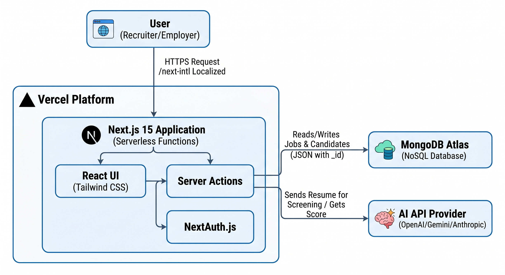

# Umurava Hackathon | Aksumite-Toumai — AI-Powered HR Intelligence
An intelligent recruitment platform built to help Human Resources professionals automatically parse, screen, and rank candidate resumes against job requirements using AI.

Umurava Hackathon: [Link](https://competence.umurava.africa/challenges/69ca12dc82d1c3e042ec8f0d)

## 📖 Project Overview
Aksumite-Toumai solves the most time-consuming part of recruitment: the initial screening phase. By leveraging artificial intelligence, our platform analyzes uploaded candidate resumes, compares them against specific job requirements, and provides a ranked, data-driven dashboard for HR teams. 

**Key Features:**
- 🌍 **Multilingual Interface:** Fully localized in English, French, and Kinyarwanda.
- 📊 **Advanced Dashboard:** Visual analytics for job postings and talent pipelines.
- 🤖 **AI Screening:** Automated resume parsing, scoring, and strength/gap analysis.
- 🔍 **Omni-Search:** Instantly filter candidates by name, AI score, or key strengths.

## 🏗️ Architecture

Our application is built using a modern, serverless stack designed for performance and scale:
- **Frontend:** Next.js 15 (App Router), React, Tailwind CSS
- **Backend:** Next.js Server Actions & API Routes
- **Database:** MongoDB Atlas (NoSQL for flexible resume data storage)
- **Authentication:** NextAuth.js (Session-based secure logins)
- **Internationalization:** `next-intl`
- **Deployment:** Vercel (Continuous Deployment)



## Tech Stack

- **Full-stack:** Next.js 16 (App Router, TypeScript) — UI, API routes, and server actions in one codebase
- **Database:** MongoDB
- **Auth:** NextAuth.js + bcrypt
- **AI:** Google Gemini (`@google/genai`)
- **Parsing:** LlamaParse (PDF), PapaParse (CSV), xlsx (Excel)
- **Styling:** Tailwind CSS

## ⚙️ Setup Instructions

### Prerequisites

- Node.js v20+
- pnpm
- MongoDB (local or Atlas)
- Gemini API key ([Google AI Studio](https://aistudio.google.com/apikey))
- LlamaCloud API key ([LlamaCloud](https://cloud.llamaindex.ai))

### Setup

```bash
pnpm install
cp .env.example .env.local   # then fill in your keys
pnpm dev
```

Visit http://localhost:3000.

### Environment variables

```
MONGODB_URL=mongodb://localhost:27017
DATABASE_NAME=umurava_hackathon_db
GEMINI_API_KEY=your_gemini_key
GEMINI_MODEL=gemini-2.5-flash
LLAMA_CLOUD_API_KEY=your_llama_cloud_key
MAX_UPLOAD_SIZE_MB=10
AUTH_SECRET=$(openssl rand -base64 32)
```

## Usage

1. Register at `/auth/register`
2. Log in at `/auth/login`
3. Create a job (role, company, required skills, experience, description)
4. Open the job detail page
5. Upload candidate files (CSV / Excel / PDF) — parsed and stored automatically
6. Click **Screen Candidates** — one Gemini call scores and ranks everyone
7. View ranked shortlist with score breakdown, strengths, gaps, and recommendation

## Project Structure

```
.
├── app/
│   ├── api/                  # API route handlers
│   │   ├── users/            # register, login, get user
│   │   └── jobs/             # CRUD + upload + screen + candidates
│   ├── auth/                 # login / register pages
│   ├── dashboard/            # recruiter dashboard, job views, results
│   ├── lib/
│   │   ├── db/mongodb.ts     # cached MongoDB client
│   │   ├── schemas/          # Zod + TypeScript types
│   │   ├── services/         # parsing + screening business logic
│   │   ├── actions.ts        # server actions for forms
│   │   └── data.ts           # read-side data fetching
│   └── ui/                   # UI components
├── auth.ts                   # NextAuth config
└── auth.config.ts
```

## Scoring Weights

| Category | Weight |
|---|---|
| Work Experience | 30% |
| Skills Match | 25% |
| Projects & Portfolio | 15% |
| Education | 12% |
| Certifications | 10% |
| Other (extracurriculars, leadership) | 8% |

## Screening Flow

```
Create Job → Upload files (CSV/PDF) → Click "Screen Candidates"
   ↓
LlamaParse / PapaParse / xlsx → parsed candidates in MongoDB
   ↓
ONE Gemini call with job + all candidates
   ↓
Scored, ranked, explained → shown in sidebar
```

## Checks

```bash
pnpm exec tsc --noEmit    # typecheck
```
